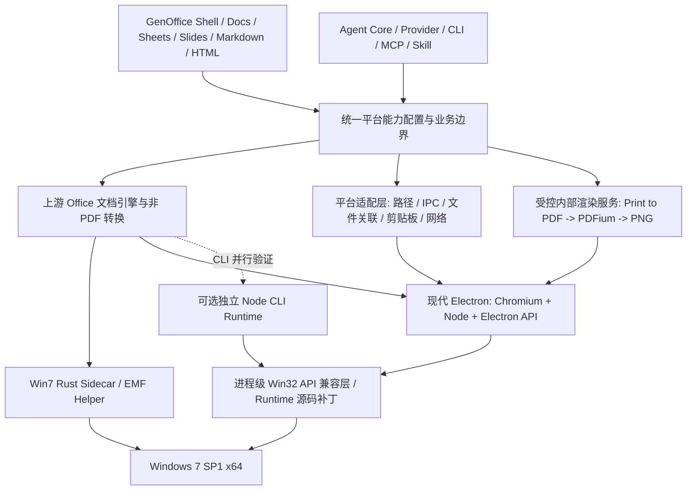
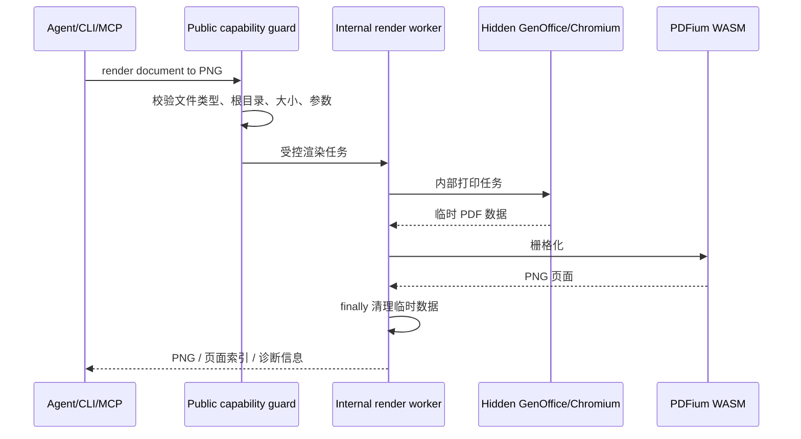

# GenOffice Win7 兼容发行版技术实施方案

> 版本：V1.0｜编制日期：2026-11-24｜状态：待实施与实机验证  
> 项目建议名：`genoffice-win7`（正式发布采用自有品牌，遵守上游商标条款）  
> 目标平台：Windows 7 SP1 x64；原生本地运行、离线安装、内网模型接入  
> 上游：[genspark-ai/genoffice](https://github.com/genspark-ai/genoffice)  
> 本次源码调查基线：`99865c27f685f1e7f40d6df273545db8ea86aa17`；实施开始时复核并锁定实际 commit、lockfile 和构建产物。

## 1. 项目背景与总体结论

GenOffice 是由 Electron 桌面壳、React 编辑界面、TypeScript 文档引擎、Rust Excel 原生 Sidecar、AI Agent、CLI 和 MCP 等模块组成的本地 AI Office 套件。其核心 Office 引擎与操作系统相对解耦，有条件在保留官方业务能力的前提下移植至 Win7。

本项目不追求复刻 PDF 编辑器，而是以 Word、Excel、PPT、Markdown、HTML 为核心，完整保留非 PDF 范围内的上游功能和智能体视觉反馈闭环，裁剪所有面向用户或外部 Agent 的 PDF 业务能力。允许 PDF 作为内部不可见的渲染中间格式，不允许由此重新暴露 PDF 阅读、转换、OCR 或文件输出服务。

**技术路线：兼容层优先、现代运行时优先、原生组件独立适配、业务层最小变更、按能力配置裁剪、持续对齐上游。** 首先用 VxKex 等现成兼容层验证官方运行时；若未通过，再按缺陷证据选择局部补丁或维护现代 Electron 兼容构建。不得将 Electron 22 或 Node 16 作为长期正式发行基线，不得将重写前端、全面降级依赖作为默认路线。

当前判断是有条件可行，尚不能承诺完整可用。Electron 的多进程、沙箱与图形渲染是决定性门禁；PDF 业务裁剪消除了 Windows 10 OCR 服务依赖，但不解决 Electron 本身的兼容问题。既有勾选清单在本方案中仅作为目标范围输入，不视为已完成实机测试证据。

## 2. 目标、范围与约束

### 2.1 目标能力矩阵

| ID | 能力 | 交付策略 | 验收要求 |
|---|---|---|---|
| F01 | 桌面 Shell、多标签、多窗口、文件打开与保存 | 完整保留 | 与同基线上游行为一致 |
| F02 | DOCX 原生编辑、分页、样式、表格、图片、审阅等上游已有能力 | 完整保留 | 保持上游已支持能力与未触碰内容 |
| F03 | XLSX 原生编辑、公式、格式、图表、工作表、筛选等 | 完整保留 | Sidecar 协议、计算结果、保存行为对齐 |
| F04 | PPTX 原生编辑、母版、主题、图形、媒体及上游支持的信息保留 | 完整保留 | 编辑与逐页视觉审查正常；不承诺上游本身未实现的功能 |
| F05 | Markdown、Mermaid、数学公式、HTML 编辑及其非 PDF 转换 | 完整保留 | 显示、编辑、导入导出与上游一致 |
| F06 | AI 对话、Agent 多步调用、编辑、撤销/确认、流式响应 | 完整保留 | 内网 OpenAI-compatible API 可用 |
| F07 | CLI、MCP stdio/HTTP、Skill、Agent 外部集成 | 保留所有非 PDF 业务 | 工具发现与执行契约一致，能力声明准确 |
| F08 | Office 页面 PNG、PPT 逐页图像、元素裁图、联系表、布局审查 | 完整保留 | 可供 Agent 实际检查和迭代 |
| F09 | 非 PDF 文件关联、中文输入、剪贴板、窗口与离线安装升级 | 完整保留 | 普通用户可用；EMF 等上游能力不静默退化 |
| F10 | PDF 阅读、编辑、OCR、扫描件恢复 | 全部裁剪 | 无入口、无后台工具、无专属 OCR 可执行文件 |
| F11 | PDF 导入、附件解析、合并、转换、创建、导出及外部 PDF 打印输出 | 全部裁剪 | GUI/CLI/MCP/Agent/直接 IPC 均拒绝 |
| F12 | 内部 PDF 打印及 PDFium 栅格化 | 保留实现依赖 | 仅可由受控的非 PDF→PNG 任务触发，不提供外部 PDF 服务 |
| F13 | Genspark 云账号、外网搜索、媒体生成等 | 内网部署配置隔离 | 允许配置自建等价服务；无外网替代服务时显式不可用，不伪造成功 |

保留的是**锁定上游基线实际具备的能力**，而非声称支持所有 Microsoft Office 规范或所有动画播放功能。旧格式 `.doc/.xls/.ppt`、ODF、HWP 等非 PDF 转换按上游现有范围纳入回归。物理打印若属于上游非 PDF 能力则保留；若实现只提供 PDF 文件输出则裁剪该入口，且不得绕过外部 PDF 输出禁用策略。虚拟 PDF 打印机及操作系统自身的打印行为不属于本软件可全面控制的范围。

### 2.2 约束及默认假设

- 首期仅 Windows 7 SP1 x64；不纳入 32 位 Win7、XP、Vista。以组织实际补丁与显卡驱动状态为支持矩阵，不能假定任何目标终端已经安装兼容层。
- 开发构建在受支持的 Win10/11 或 Linux 构建机完成；Win7 是部署与验收环境，不要求安装 npm、Rust、Python 或新版 PowerShell 开发工具链。
- 内网没有外部软件源和 SaaS。运行期依赖随包导入，业务联网仅走批准的内部端点；禁用遥测、外部更新检查、外部搜索默认回退等。
- 不修改系统核心 DLL，不全局启用注入，不以永久 `--no-sandbox`、关闭证书检查、`nodeIntegration: true` 或扩大文件权限换取兼容性。
- 允许自有构建的兼容 DLL、进程级 VxKex 配置和有证据支持的上游 Runtime 补丁，但须经过终端安全审批。若组织不允许此类机制，则本地现代桌面版路线可能不可行。
- 用户未明确要求系统级禁止任何 PDF 文件产生，故默认仅禁止外部 PDF 业务，允许受控内部中间文件。若要求进程中完全不存在 PDFium 或 PDF 数据，必须另立渲染替换任务，不能按本方案宣称已彻底移除。

## 3. 源码基线与技术依赖调查

以下为本次仓库读取所见的版本和结构；不是已完成的 Win7 兼容性结论。

| 组件 | 已确认事实 | 处理策略 |
|---|---|---|
| 根工程 | npm workspaces；`engines.node >=22.12.0`，npm >=10 | 在现代构建机复现 `npm ci` |
| Electron | Shell 声明 `^43.8.8`，本次 lockfile 解析为 `43.8.10`；Shell 打包取安装的 Electron 版本 | 锁定精确版本，验证真实打包产物 |
| Chromium / Node | Electron 43.8.10 对应 Chromium 150.0.7871.250、Node 24.22.1（Electron 发布记录） | 现代 Runtime 优先，不用系统 Node 替换 Electron 内置 Node |
| UI | React 19.2、Vite 7.3、Tiptap 3.31、Univer 0.25 | 保留原依赖及 UI 架构 |
| Shell | `WebContentsView` 多标签；Vite 主进程配置外置 `node:sqlite` | 验证真实 API，而非仅测试启动 |
| XLSX | Rust Edition 2024，calamine 0.37、ironcalc 0.9.1；独立 Sidecar | 现代 Rust 的 Win7 目标重编译 |
| Windows 剪贴板 | `win-clipboard-helper` 独立 Rust 程序，Win32 GDI/OLE 等 | 兼容编译、EMF 行为测试 |
| CLI | esbuild target=node22；官方 cmd 通过 `ELECTRON_RUN_AS_NODE=1` 执行 `GenOffice.exe`；jsdom lock 为 28.1.0 | 优先复用已适配 Electron，独立 Node 作为并行工具链/备选 |
| PDF | `apps/pdf`；C# `win-ocr.exe` 调用 `Windows.Media.Ocr` | 裁剪业务入口、OCR 构建和打包 |
| 渲染 | `renderToPngs` 调用 `exportViaApp` 打印临时 PDF，再 `rasterizePdf` | 保留并封装内部路径 |

上游是私有开发树向公开仓库同步快照的模式。升级时应基于上游 commit 差异和完整功能矩阵，而非假定每个上游修改都有独立公开提交。

## 4. 总体技术架构



架构分为四类职责：

1. **上游业务层**：尽量原样保留文档模型、引擎、操作语义、编辑界面和 Agent 工作流。
2. **能力与平台适配层**：集中管理 Win7 平台差异、PDF 功能策略、内部渲染权限以及离线配置；不向各个业务包扩散大量 `if (win7)`。
3. **Runtime 和原生层**：现代 Electron/Node 兼容构建、VxKex 配置、Rust 原生组件，独立版本化并记录 ABI 与接口契约。
4. **部署与验证层**：可复现构建、离线安装、测试基线、日志、签名和升级回滚。

## 5. Runtime 兼容路线

### 5.1 可复用项目与边界

| 项目 | 用途 | 使用限制 |
|---|---|---|
| [CopperFr/VxKex](https://github.com/CopperFr/VxKex) | 补充旧系统缺失 API、进程级应用兼容 | 兼容清单报告有现代 Electron 应用，但不等于 Electron 43 完整通过；其 IFEO/Verifier DLL 机制需安全审批 |
| [vxkex-dev/vxkex](https://github.com/vxkex-dev/vxkex) | 备选兼容实现、补丁对比 | 不叠加启用多个注入层，避免冲突；版本、许可、来源逐一核查 |
| [Supermium](https://github.com/win32ss/supermium) | 现代 Chromium 的旧 Windows 移植参考 | 对齐精确 Chromium 分支、检查源码与许可；不能直接替换 Electron DLL，亦不能假设其沙箱补丁可无修改复用 |
| [Node.js Win7 移植参考](https://github.com/vladimir-andreevich/node.js-windows-7) | Node/libuv/Windows API 移植参考 | 核验是否有满足实际依赖的 Node 22/24 构建；旧版本的存在不代表可运行当前 CLI |
| [Rust Win7 Target](https://doc.rust-lang.org/rustc/platform-support/win7-windows-msvc.html) | 现代 Rust 的 Win7 x64 编译目标 | Tier 3，需自行构建标准库；依赖与最终 PE 仍需审计 |

Python、PowerShell 的现代 Win7 兼容成果可作为通用运行时工程参考，但并非 GenOffice 核心硬依赖。首期不要引入不必要的运行时；若上游某个保留的工具明确调用它们，再独立验证并纳入部署包。

### 5.2 路线决策树

- **R0：基线直跑**。在干净 Win7 快照上运行官方解包版和精确版本的 Electron 最小应用，取得失败证据；不先修改业务代码。
- **R1：现有兼容层**。经审批启用 VxKex，按需设置兼容选项，验证父/子进程覆盖。优先选择此路线，若全部 Runtime 门禁通过则不自行编译 Electron。
- **R2：有限兼容补丁**。依据导入缺失、动态 API、栈和行为差异选择局部 DLL/API 适配或 Electron/Node 源码小补丁，优先复用已有实现。严禁以空实现或无条件成功伪造安全关键 API 的语义。
- **R3：现代 Electron 源码构建**。R2 无法修复 Chromium 核心问题时，按锁定 Electron tag 获取 Electron/Chromium/V8/Node/libuv 依赖，按需移植 Supermium 同源补丁；保留 Electron patch stack 和现代 API。使用受支持的构建系统与上游 GN/Ninja 工具链，先构建未修改的对照 Runtime，再逐组引入 Win7 补丁。
- **R4：停止或改路线**。若沙箱、进程隔离、文档完整性或安全政策不可满足，禁止将缺陷构建发布为完整版。可独立交付受验证的 CLI 或采用现代服务器 + Win7 客户端，但须另行批准，不能冒充本地全功能桌面版。

R3 是高成本备选而非必经阶段。只要 R1/R2 满足所有门禁，就不应为追求自建 Runtime 而维护整个 Chromium fork。

### 5.3 Runtime 最小验证工程

建议创建 `compat/runtime-probe/`，包含 `main.cjs`、`preload.cjs`、`renderer.html`、测试驱动和结果 JSON。构建环境使用锁定的 Electron；目标机运行解包产物。以下命令为探测示例，未在 Win7 实机执行：

```bat
@echo off
set ELECTRON_RUN_AS_NODE=1
electron.exe -e "console.log(JSON.stringify(process.versions))"
electron.exe -e "const {DatabaseSync}=require('node:sqlite'); const db=new DatabaseSync(':memory:'); console.log(db.prepare('SELECT 1 AS ok').get())"
set ELECTRON_RUN_AS_NODE=
electron.exe path\to\runtime-probe
```

如果发行包的 Electron fuse 禁用 RunAsNode，使用独立测试版 Electron 探测；正式包则验证 CLI 实际入口，不为探测而放松发布安全配置。

| Gate | 最小测试 | 必须满足 |
|---|---|---|
| RT01 | EXE 启动、PE 导入、版本输出 | 无加载器错误、无异常缺失 API |
| RT02 | Node fs、crypto、sqlite、child_process、网络、流 | 文件读写与同步、子进程生命周期、TLS/SSE 与 SQLite 行为正确 |
| RT03 | BrowserWindow + WebContentsView | 至少五个 view，可切换、销毁、重建；弹出窗口正常 |
| RT04 | sandbox、contextIsolation、preload、IPC | renderer 不获 Node/任意文件访问权限；受控 IPC 可用；拒绝越权调用 |
| RT05 | Canvas 2D、WASM、Worker、字体、中文输入 | 无崩溃，正常交互，渲染功能存在 |
| RT06 | 隐藏窗口 `printToPDF` + PDFium WASM | 产生有效内部临时数据及 PNG；无外部 PDF 入口 |
| RT07 | GPU/软件渲染对照 | 目标硬件至少一条受支持稳定路径；回退经保真/性能验证 |
| RT08 | 文件对话框、拖放、剪贴板、快捷键、DPI | 与正式终端使用方式一致 |
| RT09 | 反复启停、多进程回收、异常恢复 | 无持续泄漏、僵尸进程或系统级异常 |

记录 Win7 SP1 补丁、CPU 指令集、GPU/驱动、运行时 hash、兼容层版本和配置、进程树、失败栈以及每个 Gate 的结果。静态导入检查不能替代动态测试；需同时覆盖延迟加载、`GetProcAddress`、子进程、WASM 和真实工作负载。

### 5.4 缺陷分类与修复优先级

| 类型 | 方法 | 不可接受的处理 |
|---|---|---|
| EXE 加载 / API 导入 | PE 导入扫描、兼容层日志、WinDbg、ProcMon | 随意替换系统 DLL |
| OS 版本判断 | 局部兼容选项或源码平台判定 | 全局欺骗 OS 后忽略真实 API 行为 |
| Win32 API 语义 | 复用兼容实现、编写行为测试、必要时源码降级实现 | 伪造安全/访问控制成功 |
| Chromium/V8/libuv | 精确版本补丁、逐组构建并测最小工程 | 混用不匹配的 Chromium/Node DLL |
| 沙箱/IPC | 保护模型与 Win7 实际能力验证；安全评审 | 永久关闭 sandbox 或扩大权限 |
| GPU/字体/打印 | 对比官方环境、软件渲染作为受控可选配置 | 默认关闭全部图形功能、隐式丢失 PNG 能力 |

## 6. PDF 功能裁剪与内部渲染设计

### 6.1 能力配置：单一事实来源

建议新增 `packages/platform-capabilities/`，定义编译期 profile，供 Shell、编辑器、CLI、MCP、Skill 生成和打包脚本共享。以下为设计接口，不是上游已有实现：

```ts
export type Profile = 'upstream' | 'win7-office';
export interface Capabilities {
  editors: { docs: boolean; sheets: boolean; slides: boolean;
    markdown: boolean; html: boolean; pdf: boolean };
  pdf: { open: boolean; edit: boolean; import: boolean; export: boolean;
    attachment: boolean; ocr: boolean; publicTools: boolean };
  internal: { officePageRendering: boolean };
  integrations: { agent: boolean; cli: boolean; mcp: boolean };
}
export const win7Office: Capabilities = {
  editors: { docs: true, sheets: true, slides: true,
    markdown: true, html: true, pdf: false },
  pdf: { open: false, edit: false, import: false, export: false,
    attachment: false, ocr: false, publicTools: false },
  internal: { officePageRendering: true },
  integrations: { agent: true, cli: true, mcp: true },
};
```

生成构建期常量和可机器读取的 manifest；打包脚本使用同一数据源。正式版能力不可由普通用户环境变量、CLI 参数或 Renderer 自行开启；开发版可以使用独立 profile 验证上游完整功能。运行时接口同时执行后端策略，不只隐藏按钮。

### 6.2 源码变更面（实际实施先建立调用图）

| 上游路径/模块 | 改造任务 |
|---|---|
| 根 `package.json` | 新增 `build:win7`、`dist:win7`、`test:win7`；跳过 PDF editor 构建，保留上游构建命令 |
| `apps/shell/src/main/index.ts` 及相关模块 | PDF App 注册、窗口/标签页、打开、拖拽、关联、恢复会话和系统菜单受 profile 管理 |
| Shell 与各编辑器 renderer/preload | 移除 PDF 菜单、快捷键、首页卡片、导入/导出按钮、帮助、文件选择器过滤项；IPC 后端拒绝已裁剪操作 |
| `apps/shell/electron-builder.cjs` | 不打包 `modules/pdf`、OCR helper、PDF 文件关联与无用资源；保留内部 PDFium WASM 及实际依赖 |
| `packages/pdf2docx/ocr-helper` | Win7 profile 不构建、不调用、不分发 Windows OCR；不删除上游源文件 |
| `packages/cli/src/registry.ts` 及命令实现 | `pdf` 命令与 `create --type pdf` 等拒绝；`convert` 保留非 PDF 路由；`info`、`open`、`merge`、`render`、`selection` 等限制 PDF 输入或输出 |
| `packages/cli/src/mcp/tools.ts` 及 MCP 服务 | 不注册 `create_pdf`、`pdf_read` 等；更新其余工具 schema/描述/运行时校验；stdio、HTTP 和应用内 MCP 均覆盖 |
| `packages/cli/src/formats/render.ts`、`app-export.ts`、`slide-spec.ts` | 保留 Office→PNG 路径；将内部临时 PDF 能力与通用对外导出路径明确分离 |
| `packages/file-parse`、Agent 及各编辑器附件入口 | 禁止 PDF 附件、解析和 AI 工具访问 PDF 业务接口；非 PDF 附件保持原样 |
| Skill、guide、capabilities、命令帮助、国际化 | 生成 profile 对应能力描述，不诱导 Agent 选择不可用的 PDF 工具 |

注意：上游打包脚本存在从 PDF workspace 引用 HarfBuzz/WASM 资源的路径。不能在未确认依赖图前直接删除该 workspace 或清空其 `node_modules`；应移动仍被其他模块消费的资源解析路径或保留共享依赖。`PDFium` 本身需要保留许可证、NOTICE 与来源信息。

### 6.3 内部渲染接口与安全边界

现有上游路径为：`render` / `slides render` → `renderToPngs` → `exportViaApp(..., 'pdf', ...)` → 隐藏 GenOffice 进程 → `rasterizePdf` → PNG。该路径是 Agent 视觉闭环的基础，不得因 PDF 裁剪而消失。

建议新增内部专用渲染入口（名称示例 `--headless-render`），输入只允许受支持的非 PDF 文档及渲染参数，输出只允许 PNG、元素裁图或联系表。尽量在同一进程/私有目录内完成 PDF 生成和栅格化；若继续复用现有隐藏进程，则必须限制临时路径、任务身份、参数和输出，不能仅靠一个可伪造的环境变量授权通用 PDF 导出。



- 对外拒绝 `.pdf` 路径、PDF MIME/文件签名、伪造扩展名、PDF 导出目标，以及已裁剪子命令。兼容正常文件类型识别和大小限制，不因扩展名检查误伤合法 Office 文件。
- 内部任务使用随机私有临时目录或内存，限制权限、页数、最大分辨率、总内存、并发和超时；禁止向外部调用者返回内部 PDF 路径或字节。
- 成功、失败、取消均执行清理；启动时回收本应用残留的过期任务目录，不触碰用户其他临时文件。崩溃残留无法保证立即清除，需测试回收逻辑。
- `--headless-export ... pdf` 外部调用在 Win7 profile 中拒绝；非 PDF 导出仍受支持。PNG 预览不得返回伪造成功或用低保真占位图替代真实渲染。
- 文件内容、路径访问遵循原有沙箱和 `GENOFFICE_ALLOWED_ROOTS` 等限制；自有 guard 不得削弱上游文件边界。

## 7. Rust 原生组件适配

### 7.1 XLSX Sidecar

路径：`apps/sheets/native/xlsx-engine`。保持 Rust Edition 2024、calamine、IronCalc 等依赖和现有 JSON/进程通信协议；不把计算引擎替换成简化的 JavaScript 实现。首选现代 Rust Win7 MSVC 目标 `x86_64-win7-windows-msvc`。

构建示例（需在现代构建机选择已验证的固定 nightly/自建工具链，配置 linker 和 SDK，不是已验证可直接执行的完整脚本）：

```bash
rustup toolchain install <pinned-nightly> --component rust-src
cargo +<pinned-nightly> build -Z build-std=std,panic_abort \
  --release --locked --target x86_64-win7-windows-msvc \
  --manifest-path apps/sheets/native/xlsx-engine/Cargo.toml
```

若目标规范、panic 策略、测试标准库或 C 依赖需额外配置，按 Rust target 文档修正；不得用普通 `x86_64-pc-windows-msvc` 的编译成功代替 Win7 目标验证。生成 SBOM、记录 rustc/Cargo/SDK/linker 与 Cargo.lock。逐项检查 PE 导入、UCRT/VC runtime 依赖以及 uuid、线程、文件 I/O 等动态行为。必要时局部补丁依赖，并保存补丁来源。

通过 `XLSX_SIDECAR_PATH` 进行早期验证；正式发行放到上游期望的 `resources/native/xlsx-sidecar.exe`。验证进程启动、超时、取消、崩溃重启、批量公式、跨表引用、保存、错误传播及高并发操作。

### 7.2 Windows 剪贴板 Helper

路径：`apps/sheets/native/win-clipboard-helper`。同样使用 Win7 target 构建，重点检查 GDI、OLE、剪贴板锁定、EMF 图元、句柄释放与 Unicode 文本。确保从 GenOffice 复制表格到既有 Office 应用以及反向粘贴的上游支持场景一致。缺少 EMF 不能静默视为通过；如果 helper 暂未实现，标为未通过而不是裁剪。

## 8. CLI、MCP 与 AI 体系

### 8.1 CLI 两条实施路径

**正式路径 A：Electron 自带 Node**。保留官方 `genoffice.cmd`、`ELECTRON_RUN_AS_NODE=1` 机制及原资源布局，减少 Node 和 Electron 内嵌版本差异。验证实际发布 fuse、stdout、stderr、退出码、中文参数、长路径和子进程。

**并行路径 B：独立 Node 22/24 Win7 CLI**。在 Electron 未完成时独立验证纯文档处理、MCP 及 Sidecar，不能把该子集宣称为完整 GUI 版本。Node 版本按实际依赖 engines 和运行 API 选择，不是只满足 `target=node22` 即可。若使用独立 Node，调整 launcher/resource resolver，使 WASM、原生组件、skills、外部 npm 依赖能够按打包路径解析；`GENOFFICE_APP_BIN` 指向已适配的 GUI 才可完成依赖隐藏窗口的渲染命令。不要通过复制 DLL 替换 Electron 内置 Node。

### 8.2 MCP 与 Agent

保留上游 CLI stdio MCP、CLI HTTP MCP 及应用内可视化编辑 MCP。对每个非 PDF tool 生成能力清单，测试发现、schema、输入校验、执行、返回值、错误、资源和 guide。特别保留 `docs_read/apply/check`、`sheet_*`、`slides_read/apply/audit/render`、`deck_start/page/build/replace` 以及通用 `render` 等基线中确实存在的能力。

- stdio：标准输出只传协议数据，日志走 stderr；测试中文参数、EOF、异常退出、并发请求和重启。
- HTTP：默认仅 loopback；跨机器部署须审批、认证、文件访问限制、文件大小与请求并发限制；保留原有 token 与隔离工作目录约束。使用组织批准的传输保护，不能在不可信网络直接裸露文档服务。
- AI：使用内网 OpenAI-compatible endpoint，配置模型标识、流式输出、工具调用、超时和可取消请求；与 LiteLLM 等网关联调。密钥不写入发布包、日志或项目仓库；按组织策略存储。
- 保持 Agent 规划→生成→审查→渲染→修改→复核的闭环，不能只验证一次文档生成。
- 关闭外网遥测、自动更新、账号自动登录、在线字体/素材和搜索回退；搜索/图片/媒体 provider 通过内网服务实现时单独验收。离线不可用的云服务从能力描述中明确标记或隐藏，不伪造成功结果。
- 内网 CA/HTTPS 采用受控信任配置；不关闭 TLS 校验。验证 SSE 首包、分片、超时、中断、工具 JSON、中文长文和错误反馈。模型本身不支持工具调用属于模型能力问题，须与平台兼容故障区分。

## 9. 工程组织、构建与离线交付

### 9.1 仓库组织

建议首期仅维护一个应用 fork；Runtime 若需要独立编译或多应用复用，再拆分为 `electron-win7-runtime`，不提前引入三个仓库的维护成本。

```text
genoffice-win7/
  apps/                         # 上游应用，最小修改
  packages/
    platform-capabilities/      # 新增：能力 profile 和生成器
    ...                         # 上游 packages
  compat/
    manifest/                   # 版本、来源、SHA256、补丁、许可
    runtime-probe/              # Electron/Node 最小验证工程
    win32/                      # 进程级兼容配置及必要的自有补丁
    rust/                       # 固定 toolchain / target / build scripts
    profiles/win7-office.json    # 能力事实来源
    patches/                    # 分类补丁（有需要时）
    tests/                      # Win7 验收、基线对比、负面测试
    scripts/                    # 构建、打包、安装、诊断、回滚
  docs/win7/                    # 安装、故障处理、兼容矩阵和升级说明
```

建议维护 `upstream/main` 镜像基线、`win7/main` 可交付集成分支和阶段性主题分支 `compat/runtime-probe`、`compat/pdf-profile`、`compat/native`、`compat/package`。每次 release 记录上游 SHA、兼容补丁集版本、Electron/Node/Chromium/Rust 版本和测试结果；源码版本与运行时版本分别管理，避免一处变动导致全部重做。

### 9.2 构建流水线

1. 获取并锁定上游 commit；核对 `package-lock.json`、各 Rust `Cargo.lock`、electron-builder 版本和资源清单。
2. 在现代构建机复现原版构建和基线测试；冻结参考产物。
3. 解析、下载并离线镜像 npm tarball、Rust crates、Electron 二进制、WASM、字体、许可文件；使用固定 lockfile，登记哈希。若需 R3，额外镜像完整 Electron/Chromium 源码与工具链，避免构建中隐式下载。
4. 生成 Win7 profile；构建保留的编辑器、CLI 和 Shell；从构建 DAG 中排除 PDF editor/OCR；使用经验证的 Native Sidecar 与 Runtime。
5. 打包 portable 版本，优先排除 NSIS 安装器干扰；验证后再构建经审查的安装包。检查 PE 导入、运行资源、禁止文件、SBOM 与 NOTICE。
6. 先在 Win10/11 运行 Win7 profile 自身的功能裁剪与非 PDF 对照测试，再在 Win7 VM 和物理机上运行完整矩阵，输出结构化结果与差异证据。
7. 签名/校验发布、冻结离线导入清单；只有所有必需 Gate 通过才打正式 release。使用内网发布流程，不允许自动下载上游未适配版本。

建议新增命令（设计目标，需实际实现）：

```text
npm run build:win7
npm run dist:win7
npm run test:win7:profile
npm run test:win7:runtime
npm run test:win7:parity
npm run check:win7:package
```

### 9.3 离线交付包

```text
GenOffice-Win7-<version>-x64/
  GenOffice.exe                 # 自有品牌时同步修改名称和元数据
  ...                           # Electron DLL、locale、resources
  resources/
    modules/{docs,sheets,slides,markdown,html}/
    native/{xlsx-sidecar.exe,win-clipboard-helper.exe}
    wasm/                       # 含内部渲染所需 PDFium 与其他实际依赖
    cli/                        # CLI、Skill 及外部依赖
  prerequisites/                # 经批准可再分发的必要组件及说明
  compat/                       # 已审核的兼容配置或单独授权安装说明
  LICENSES/                     # 上游及第三方许可证和 NOTICE
  manifest.json
  SHA256SUMS
  install.cmd / uninstall.cmd   # 或审核后的离线安装器
  diagnostics.cmd
```

以上为逻辑布局，最终以打包器的真实目录结构为准。不得包含 `modules/pdf`、`win-ocr.exe` 或不必要的云服务密钥。Win7 必要补丁（如 KB2533623、KB2670838，以及实际适用的 SHA-2、UCRT 支持更新）需由终端管理审批；根据已安装的累积更新判断是否已覆盖，不重复盲装。VC/UCRT 选择仍明确支持 Win7 的版本，不假设当前最新 VC redistributable 可安装。兼容层不应在用户不知情时全局安装或修改注册表。系统补丁及第三方二进制仅在许可允许的情况下打包。

### 9.4 部署和回滚

- 先运行预检：OS/SP/架构、补丁能力、磁盘、CPU/GPU、权限、运行时与哈希。诊断输出应脱敏。
- 安装到独立目录，按审批配置特定 EXE 的兼容层；为文件关联、CLI PATH 和本地设置提供显式选项，不覆盖其他 Office 默认关联。
- 支持离线升级及回滚：并列版本安装、应用关闭后切换入口、备份用户配置和数据库、校验迁移兼容性；不得自动回滚导致文档损坏或数据库降级覆盖。
- 用户文档与应用目录分离。卸载仅清理本版本安装与自有兼容配置，保留用户文档和用户选择保留的设置；不删除其他应用共享的兼容层或系统补丁。

## 10. 实施阶段、里程碑与停止条件

以下为建议工程量，不是已执行结果。工期取决于 R1/R2 是否通过、组织审批及实机资源；阶段可并行但门禁不可跳过。

| 阶段 | 任务 | 交付件 / Gate | 粗估 |
|---|---|---|---|
| P0 基线冻结 | 下载源码、锁版本、官方构建、记录现有能力 | baseline manifest、对照产物、功能矩阵 | 2–4 人日 |
| P1 Runtime PoC | Win7 VM、官方运行时 + VxKex、RT01–RT09 | Runtime 诊断与路线决策 ADR | 3–7 人日 |
| P2 PDF profile | 配置、GUI/IPC/CLI/MCP/Skill/打包裁剪、内部渲染封装 | 现代系统 profile 测试通过、负面用例通过 | 5–12 人日 |
| P3 Native & CLI | Rust Sidecar/EMF、CLI/MCP、资源定位 | 兼容原生二进制、CLI 契约测试 | 5–15 人日 |
| P4 Runtime 补丁（条件任务） | R2 局部修复；失败则评估 R3 源码构建 | 完整 Runtime Gate；否则停止正式发布 | 局部 5–20 人日；R3 另估，可能数周至数月以上 |
| P5 集成与离线 | 全编辑器、AI 网关、安装/升级/诊断 | portable 与离线安装候选 | 5–12 人日 |
| P6 功能/保真/安全验收 | Win10/Win7 差分、实机、长时、MCP/AI、负面用例 | 完整证据包、已知问题、发布审批 | 10–20 人日 |

R1 直接通过时，以上不含 P4 的工作合计约 30–70 人日量级；可并行推进，不等同日历工期。若进入 R3，应将 Runtime 作为独立技术预研，并重新评估成本与长期更新能力，不设虚假的固定完成日期。

里程碑 M1：Runtime PoC 通过或明确阻断原因；M2：现代系统 Win7 profile 与原版非 PDF 功能对齐；M3：Win7 portable 完成非 PDF 功能；M4：离线安装候选完成；M5：保真、安全与回归验收通过并正式发布。

**停止条件**：沙箱/权限模型不满足；保存导致内容破坏；内部 PNG 渲染不可靠；关键 Office/Agent 功能退化；兼容层不获批准；目标机缺乏无法补齐的基础能力。遇到上述情况禁止通过删测试、默认关闭安全功能或缩小承诺范围来假装成功。必要时输出失败证据，转为独立 CLI 或服务端路线建议，须重新确认范围。

## 11. 验收设计与证据要求

### 11.1 三级对照

A：Win10/11 上未修改的同一上游 baseline（业务参考）。  
B：Win10/11 上 Win7 profile（隔离裁剪影响）。  
C：Win7 上同 profile（隔离 OS/Runtime 影响）。

A→B 比较非 PDF 功能与裁剪正确性，B→C 比较运行时兼容性，A→C 验收整体行为。相同 fixture、模型 mock、字体版本、DPI、渲染比例与操作步骤；记录 GPU/驱动差异。使用真实模型联调作为补充，不使用模型随机生成文本直接做逐字差分。

### 11.2 验收矩阵

| ID | 测试内容 | 判定标准 |
|---|---|---|
| T01 | Runtime RT01–RT09 | 全部通过；有日志和安全证据 |
| T02 | 全部非 PDF 标签页、窗口、打开/恢复/关闭 | 操作一致，无崩溃及残留进程 |
| T03 | DOCX 复杂分页、表格、样式、页眉页脚、中文和公式 | 编辑保存正确，分页与布局可接受且有对照 |
| T04 | XLSX 公式、跨表、图表、条件格式、筛选、批量修改 | 值/错误码/公式语义一致，无 Sidecar 静默降级 |
| T05 | PPTX 母版、主题、形状、图片、复杂文本、动画信息往返 | 基线上游支持的操作与信息保持一致 |
| T06 | Markdown、Mermaid、KaTeX、HTML 及非 PDF 转换 | 无空白渲染、资源缺失或错误导出 |
| T07 | 文件无修改往返和增量编辑 | 按上游保真契约校验未触碰 OOXML ZIP entries 和目标 XML；不误要求整 ZIP hash 必然相同 |
| T08 | 非 PDF `render`、`slides render`、裁图、联系表 | 输出页数、尺寸、元素对应、视觉一致；内部临时 PDF 不泄露 |
| T09 | Agent 多轮创建→渲染→审查→修改→再渲染 | DOCX/XLSX/PPTX 各完整执行一次以上，并核对产物 |
| T10 | CLI 非 PDF 命令全覆盖 | 对上游命令/子命令/参数清单逐条映射，退出码和结构化结果一致 |
| T11 | MCP stdio、HTTP、应用内 MCP | 工具发现、调用、鉴权、根目录、资源、超时、取消均正常 |
| T12 | 内网 LLM API | 流式、工具调用、网络断开、超时、无凭据提示正常 |
| T13 | 运行时裁剪负面测试 | `.pdf` 打开/拖拽/附件/convert/create/info/render/直接 IPC/外部 headless export 等均被拒绝 |
| T14 | 构建裁剪检查 | 不含 PDF editor/OCR helper；仅保留经过证明的内部依赖 |
| T15 | GUI/CLI/MCP/Skill 的 capability 一致性 | 无 PDF 业务工具、错误说明或自动回退诱导 |
| T16 | 中文 IME、剪贴板（EMF）、文件关联、DPI、窗口 | 基线所支持的功能无隐式降级 |
| T17 | 离线安装、升级、回滚、卸载 | 无外网下载；文档和设置按策略保留；不破坏其他软件 |
| T18 | 长时间运行、重复打开、复杂/大文档、并发 Agent | 无崩溃、数据丢失或无界内存增长；可回收资源 |
| T19 | 安全、网络白名单、沙箱、IPC、临时文件权限 | 安全评审通过；无未批准外连，无越权；失败能清理 |

### 11.3 量化建议（首期阈值须用实际终端校准）

- 19 类必需测试全部通过；按子用例统计覆盖率和通过率，阻断级/高严重度缺陷为零。未执行或证据不足不得标通过。
- 初始 fixture 建议 DOCX/XLSX/PPTX 各不少于 20 个覆盖常见与复杂结构的样本；Markdown/HTML 各不少于 5 个；非 PDF 旧格式按支持范围各准备典型样本。使用公开或合成文件，不擅自外传内网业务文档。
- 至少一台 VM 和两种代表性物理终端配置；涵盖实际使用的中文输入法、显示缩放、显卡驱动与 Office 剪贴板互操作。无法获得代表硬件时不得扩大兼容承诺。
- 建议 8 小时连续工作负载、100 次打开/关闭循环；记录峰值和回落内存、进程数、卡顿、崩溃与文件错误。性能先对照同硬件可支持参考环境或固定 VM；初始目标可设关键操作 P95 不超过参考的 2 倍，实际门槛须审批且不得掩盖不可用交互。
- PNG 视觉比较：统一字体/分辨率/缩放，检查页数、文字是否缺失、分页、元素位置、图表与图片，使用像素 diff/SSIM 辅助。不要把单一 SSIM 数字当作保真证明；抗锯齿差异允许有记录的容差，语义缺失、遮挡、截断不允许。
- OOXML 比较：解压并按基线契约验证未修改的部件字节、关系、媒体、样式、宏或未知内容的保留情况（仅针对上游承诺）；另用结构化 XML 差分检查指定修改，不因 ZIP 元数据变化误判。
- 安全测试需确认 Renderer sandbox/context isolation、IPC 白名单、MCP 根目录与 token、禁用外部 PDF 业务路径；用进程树、实际权限行为和日志证明，不仅检查布尔配置。

结果建议采用 JSON：`test_id, upstream_sha, profile, runtime_sha, os_build, fixture_sha, expected, actual, status, evidence_path, duration_ms, defect_id`，状态仅 `pass/fail/blocked/not-run`；正式 release 报告附全部证据路径及未解决问题。

## 12. 风险与安全合规

| 风险 | 影响 | 缓解措施 |
|---|---|---|
| Electron 43 在 Win7 缺失核心 OS API | 最高，可能阻断整个 GUI | 最先做 Runtime Gate；必要时进入 R2/R3；保留停止条件 |
| VxKex 注入与终端管控冲突 | 高 | 预先审批、限定进程、可卸载、来源核验；不规避终端防护 |
| Chromium sandbox 旧系统语义不等价 | 高 | 验证安全模型；不能以永久禁用沙箱替代 |
| PNG 中间渲染被误裁剪 | 高 | 保留独立内部服务、契约与 Agent 端到端测试 |
| Rust 依赖引入 Win10 API | 中高 | Win7 target 自建 std、PE/动态扫描、逐 crate 修复 |
| Office 保存/布局差异 | 高 | 三级对照、真实样本和结构/视觉证据 |
| 外网 provider、更新与遥测隐式访问 | 高 | profile 默认离线、白名单、网络审计、显式禁用 |
| 上游快速变化和补丁冲突 | 中高 | 小补丁、固定版本、自动能力 diff、Runtime 版本独立 |
| 第三方兼容项目来源/许可 | 高 | 审阅源码、hash/签名、SBOM、许可证、补丁可追溯 |
| Win7 操作系统本身停止常规安全支持 | 高且不可完全消除 | 内网隔离、最小权限、文件来源管控、批准使用；不得将应用兼容等同于 OS 安全恢复 |

上游 Apache-2.0 范围与 `ee/` 企业许可须分别核查，未经授权不将企业模块并入发行；正式 fork 使用自有品牌。Supermium、VxKex、Rust、Electron、字体、WASM 等第三方许可和再分发义务以锁定版本的真实文件为准。所有外来组件经组织审批后进入内网，业务文件和密钥不得用于公开 CI 或外部诊断。

## 13. 持续对齐上游与维护机制

每个上游快照执行：锁定新 SHA→生成依赖/API/命令/菜单/资源 diff→更新兼容补丁→运行上游非 PDF 测试→运行 B/C 对照测试→出具差异与风险→发布。禁止原版 auto-update 直接覆盖 Win7 版本。

持续检查：Electron/Chromium/Node 版本变化、WebContentsView 等 API、Node 新 built-in、Rust MSRV 和依赖、PDF 新入口、MCP tool schema、Skill 说明、网络 provider、打包资源。为 PDF profile 建立自动检测新增工具/路由/文件关联的回归用例，而不是依靠人工检查菜单。

每个补丁写明原因、上游路径、适用 Runtime、测试、是否可回送上游以及移除条件。发布记录附上 `baseline-diff.md`（新增/删除/行为改变/未对齐/已知缺陷）、运行时 manifest、安装包、许可清单和测试报告。上游新增的非 PDF 能力默认纳入新基线目标；若有暂未对齐项则不得标记为完整对齐。

## 14. 首轮 Codex 执行指引

首轮任务的目标不是直接宣布移植完成，而是冻结基线、建立可执行门禁、减少后续盲目修改。

| 任务 | 可直接下发的工作内容 | 输出 |
|---|---|---|
| W00 | 克隆并固定上游，复核 lockfile 和源码树；列出所有非 PDF 能力及 PDF 调用路径 | `compat/manifest/baseline.json`、`docs/win7/upstream-audit.md` |
| W01 | 搭建最小 Electron probe，覆盖 RT01–RT09；实现结果 JSON、诊断命令与 Win7 运行说明 | `compat/runtime-probe/`、`docs/win7/runtime-test.md` |
| W02 | 在现代系统实现 win7-office profile；仅裁剪 PDF 业务；验证内部渲染；编写拒绝用例 | profile 生成器、构建改造、测试 |
| W03 | 固定 Rust Win7 target 工具链；构建 Sidecar 与 EMF helper；输出 PE 导入审查及测试 | 原生二进制候选、构建脚本、报告 |
| W04 | 建立 CLI/MCP 契约测试，独立 Node 验证路径可选；完成内网模型配置及网络负面测试 | CLI/MCP/AI 测试矩阵 |
| W05 | 待 P1 真实结果决定 R1/R2/R3；不得自动假定 VxKex 可用或擅自编译整个 Chromium | `ADR-001-runtime-route.md`、补丁和证据 |
| W06 | 整合 portable 与离线安装；完成 A/B/C 对照与正式发布证据包 | 安装包、SBOM、hash、验收报告 |

Codex 应遵循以下约束：读取现有工程规范；先定位真实调用关系再改源码；不修改锁定上游基线本身；不做与兼容无关的大规模重构；优先测试驱动；每个变更以最小范围提交；不将未执行的 Win7 测试标记为通过。若无法访问真实 Win7 环境，完成可执行测试和现代系统可验证工作，并明确列出 `blocked/not-run`，由具备实机的人员回填证据。

建议先生成 `docs/win7/IMPLEMENTATION_STATUS.md`，逐项记录任务、负责人、前置依赖、状态和实际证据。任何新增裁剪项、重大依赖降级、沙箱变化和部署范围变化必须通过 ADR 审批，而不是由执行智能体自行决定。

## 15. 交付清单与项目完成定义

最终交付：应用源码 fork、必要 Runtime 补丁/构建配置、可复现离线构建脚本、Win7 portable 与安装版、独立 CLI（若采用）、许可/SBOM/哈希、部署与升级文档、Win7 支持矩阵、非 PDF 功能差异表、测试证据、安全审查报告、已知缺陷及回滚说明。

**完成定义：在批准的 Win7 SP1 x64 支持矩阵内，应用本地运行，所有目标非 PDF 功能通过验收，Office 文件保真与 Agent 视觉反馈闭环保留，PDF 对外业务完全禁用，离线部署可复现，并且不存在未批准的安全退化。** 若仅能完成 CLI 或仅能启动 GUI，不得使用“全功能兼容发行版”的发布声明。

## 附录 A：源码及外部参考

源码事实来自本次读取的公开仓库快照；实际实施固定 commit 后重新确认路径与版本。以下链接用于工程核查：

- [GenOffice README](https://github.com/genspark-ai/genoffice/blob/main/README.md)、[CONTRIBUTING](https://github.com/genspark-ai/genoffice/blob/main/CONTRIBUTING.md)、[根 package.json](https://github.com/genspark-ai/genoffice/blob/main/package.json)、[package-lock.json](https://github.com/genspark-ai/genoffice/blob/main/package-lock.json)
- [Shell package.json](https://github.com/genspark-ai/genoffice/blob/main/apps/shell/package.json)、[Shell main](https://github.com/genspark-ai/genoffice/blob/main/apps/shell/src/main/index.ts)、[Vite 配置](https://github.com/genspark-ai/genoffice/blob/main/apps/shell/electron.vite.config.ts)、[打包配置](https://github.com/genspark-ai/genoffice/blob/main/apps/shell/electron-builder.cjs)
- [CLI package.json](https://github.com/genspark-ai/genoffice/blob/main/packages/cli/package.json)、[CLI 构建](https://github.com/genspark-ai/genoffice/blob/main/packages/cli/build.mjs)、[Windows launcher](https://github.com/genspark-ai/genoffice/blob/main/packages/cli/bin/genoffice.cmd)、[资源解析](https://github.com/genspark-ai/genoffice/blob/main/packages/cli/src/resources.ts)
- [render.ts](https://github.com/genspark-ai/genoffice/blob/main/packages/cli/src/formats/render.ts)、[app-export.ts](https://github.com/genspark-ai/genoffice/blob/main/packages/cli/src/formats/app-export.ts)、[slides 命令](https://github.com/genspark-ai/genoffice/blob/main/packages/cli/src/commands/slides.ts)、[MCP tools](https://github.com/genspark-ai/genoffice/blob/main/packages/cli/src/mcp/tools.ts)
- [XLSX Sidecar Cargo.toml](https://github.com/genspark-ai/genoffice/blob/main/apps/sheets/native/xlsx-engine/Cargo.toml)、[剪贴板 Cargo.toml](https://github.com/genspark-ai/genoffice/blob/main/apps/sheets/native/win-clipboard-helper/Cargo.toml)、[Windows OCR helper](https://github.com/genspark-ai/genoffice/blob/main/packages/pdf2docx/ocr-helper/win-ocr.cs)
- [Electron 43 发布版本表](https://releases.electronjs.org/release?channel=stable&major=v43)、[Electron 官方 Win7/8/8.1 支持终止说明](https://www.electronjs.org/blog/windows-7-to-8-1-deprecation-notice)
- [VxKex](https://github.com/CopperFr/VxKex)、[VxKex 兼容清单](https://github.com/CopperFr/VxKex/wiki/Application-Compatibility-List)、[Supermium](https://github.com/win32ss/supermium)、[Rust Win7 target](https://doc.rust-lang.org/rustc/platform-support/win7-windows-msvc.html)、[Rust Windows target 基线变更](https://blog.rust-lang.org/2024/02/26/Windows-7/)

## 附录 B：待确认事项

1. 实际 Win7 终端补丁、CPU/GPU/驱动、权限与可安装兼容层的政策；是否允许 IFEO 配置和自有 Runtime。
2. Electron 43.8.10 在目标机上真实的加载、沙箱、图形和内部 PDF 打印结果；目前没有实测证据。
3. 内网 AI 搜索/媒体 provider 是否存在，若不存在则确认部署 profile 的功能显式限制；不属于 Win7 Runtime 缺陷。
4. 组织签名、软件导入与第三方许可证审批方式；可用的现代构建机和 Win7 VM/物理机资源。
5. 真实文档集、现有 Office 互操作版本与视觉/性能阈值。本文的数量、阶段人日和验收阈值均为建议，不是用户已批准的硬性指标。

